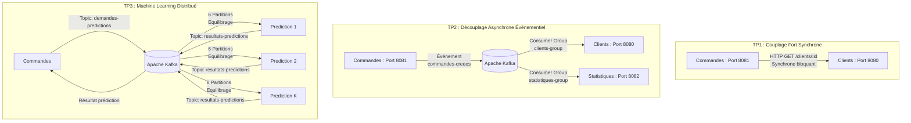

# Guide de Démonstration & Présentation : TP1, TP2 et TP3
> **Architecture de Microservices Python : De l'API REST au Machine Learning en Streaming avec Apache Kafka**  
> *Promotion ING 3 - Data Science / Big Data 2026*

Ce document est conçu pour présenter et expliquer l'ensemble des travaux réalisés au professeur, avec les extraits de code commentés, les schémas d'architecture et les commandes pas-à-pas à exécuter lors de la soutenance.

---

## Sommaire
1. [Vue d'ensemble et Évolution de l'Architecture](#1-vue-densemble-et-évolution-de-larchitecture)
2. [TP1 : Communication Synchrone via API REST](#2-tp1--communication-synchrone-via-api-rest)
   - [Principe & Schéma](#principe--schéma-tp1)
   - [Codes sources clés](#codes-sources-clés-tp1)
   - [Démonstration pas-à-pas](#démonstration-pas-à-pas-tp1)
3. [TP2 : Communication Asynchrone avec Apache Kafka](#3-tp2--communication-asynchrone-avec-apache-kafka)
   - [Principe & Schéma](#principe--schéma-tp2)
   - [Codes sources clés](#codes-sources-clés-tp2)
   - [Démonstration pas-à-pas & Résilience](#démonstration-pas-à-pas--résilience-tp2)
4. [TP3 : Intégration du Machine Learning en Streaming](#4-tp3--intégration-du-machine-learning-en-streaming)
   - [Principe & Schéma](#principe--schéma-tp3)
   - [Entraînement Offline vs Inférence Streaming](#entraînement-offline-vs-inférence-streaming)
   - [Codes sources clés](#codes-sources-clés-tp3)
   - [Questions Avancées (Scaling K instances, Flux infini, Résilience)](#questions-avancées-tp3)
5. [Récapitulatif des Commandes pour la Soutenance](#5-récapitulatif-des-commandes-pour-la-soutenance)

---

## 1. Vue d'ensemble et Évolution de l'Architecture

Le projet illustre la transition progressive d'une architecture monolithique/couplée vers une architecture orientée événements hautement scalable :



---

## 2. TP1 : Communication Synchrone via API REST

### Principe & Schéma TP1
- Deux microservices Flask indépendants :
  - **`clients`** (port `8080`) : référentiel des clients.
  - **`commandes`** (port `8081`) : gestion des commandes.
- Lorsqu'un utilisateur demande une commande (`GET /commandes/1`), le microservice `commandes` réalise un appel HTTP sortant (`requests.get`) vers `http://clients:8080/clients/<client_id>` pour enrichir les informations avec le nom et le pays du client.
- **Limites démontrées** : Couplage fort (si le microservice `clients` est éteint, `commandes` retourne une erreur `503`).

### Codes sources clés TP1

#### A. Microservice `clients` (`clients/app.py`)
```python
from flask import Flask, jsonify

app = Flask(__name__)

clients = [
    {"id": 1, "nom": "Alice", "pays": "France"},
    {"id": 2, "nom": "Alex", "pays": "Belgique"},
    {"id": 3, "nom": "Madeleine", "pays": "France"}
]

@app.get("/clients")
def list_clients():
    return jsonify(clients)

@app.get("/clients/<int:id>")
def get_client(id):
    client = next((c for c in clients if c["id"] == id), None)
    if client:
        return jsonify(client)
    return jsonify(error="Not Found"), 404

if __name__ == "__main__":
    app.run(host="0.0.0.0", port=8080)
```

#### B. Microservice `commandes` appelant `clients` (`commandes/app.py`)
```python
import requests
from flask import Flask, jsonify

app = Flask(__name__)
CLIENTS_SERVICE_URL = "http://clients:8080"

commandes = [
    {"id": 1, "client_id": 1, "produit": "PC", "montant": 1200},
    {"id": 2, "client_id": 2, "produit": "Livre", "montant": 30},
    {"id": 3, "client_id": 1, "produit": "Casque", "montant": 80}
]

@app.get("/commandes/<int:id>")
def get_commande(id):
    cmd = next((c for c in commandes if c["id"] == id), None)
    if not cmd:
        return jsonify(error="Commande Not Found"), 404

    # Appel REST synchrone vers le microservice clients
    try:
        resp = requests.get(f"{CLIENTS_SERVICE_URL}/clients/{cmd['client_id']}", timeout=5)
        client_data = resp.json() if resp.status_code == 200 else None
    except requests.exceptions.RequestException:
        return jsonify(error="Le service clients est indisponible", commande=cmd), 503

    return jsonify({
        "id": cmd["id"],
        "produit": cmd["produit"],
        "montant": cmd["montant"],
        "client": client_data
    })
```

### Démonstration pas-à-pas TP1

1. **Lister tous les clients :**
   ```bash
   curl http://localhost:8080/clients
   ```
2. **Récupérer une commande avec enrichissement client :**
   ```bash
   curl http://localhost:8081/commandes/1
   ```
   *Résultat attendu :*
   ```json
   {
     "id": 1,
     "produit": "PC",
     "montant": 1200,
     "client": {
       "id": 1,
       "nom": "Alice",
       "pays": "France"
     }
   }
   ```
3. **Tester la gestion d'erreurs (404) :**
   ```bash
   curl http://localhost:8080/clients/999
   # Retourne : 404 {"error": "Not Found"}
   ```

---

## 3. TP2 : Communication Asynchrone avec Apache Kafka

### Principe & Schéma TP2
- Introduction du courtier de messages **Apache Kafka** (mode KRaft dans Docker).
- Le microservice `commandes` n'appelle plus directement `clients`.
- Lorsqu'une commande est créée (`POST /commandes`), un événement JSON est déposé dans le topic `commandes-creees`.
- **Deux consommateurs distincts** écoutent en parallèle le même topic :
  1. `clients` (`group_id = "clients-group"`) : compte et maintient le nombre de commandes passées par chaque client.
  2. `statistiques` (`group_id = "statistiques-group"`, port `8082`) : agrège le CA par mois et les ventes par produit.

### Codes sources clés TP2

#### A. Production de l'événement Kafka (`commandes/app.py`)
```python
from kafka import KafkaProducer
import json

producer = KafkaProducer(
    bootstrap_servers=["kafka:29092"],
    value_serializer=lambda v: json.dumps(v).encode("utf-8")
)

@app.post("/commandes")
def create_commande():
    data = request.get_json()
    nouvelle_commande = {
        "id": len(commandes) + 1,
        "client_id": int(data["client_id"]),
        "produit": str(data["produit"]),
        "montant": float(data["montant"]),
        "date": data.get("date", "2026-10-12")
    }
    commandes.append(nouvelle_commande)

    # Événement publié sur Kafka
    evenement = {
        "commande_id": nouvelle_commande["id"],
        "client_id": nouvelle_commande["client_id"],
        "produit": nouvelle_commande["produit"],
        "montant": nouvelle_commande["montant"],
        "date": nouvelle_commande["date"]
    }
    producer.send("commandes-creees", value=evenement)
    producer.flush()

    return jsonify(message="Commande créée", commande=nouvelle_commande), 201
```

#### B. Consommation par le microservice Statistiques (`statistiques/app.py`)
```python
from kafka import KafkaConsumer
import json, threading

commandes_par_produit = {}
ca_par_mois = {}

def start_kafka_consumer():
    consumer = KafkaConsumer(
        "commandes-creees",
        bootstrap_servers=["kafka:29092"],
        group_id="statistiques-group",
        auto_offset_reset="earliest",
        value_deserializer=lambda m: json.loads(m.decode("utf-8"))
    )
    for message in consumer:
        data = message.value
        produit = data.get("produit")
        montant = float(data.get("montant", 0))
        mois = data.get("date", "")[:7]

        # 1. Nombre de commandes par produit
        commandes_par_produit[produit] = commandes_par_produit.get(produit, 0) + 1
        # 2. CA mensuel cumulé
        ca_par_mois[mois] = round(ca_par_mois.get(mois, 0.0) + montant, 2)
```

### Démonstration pas-à-pas & Résilience TP2

1. **Créer une commande :**
   ```bash
   curl -X POST http://localhost:8081/commandes \
     -H "Content-Type: application/json" \
     -d '{"client_id": 2, "produit": "Écran", "montant": 250, "date": "2026-10-12"}'
   ```
2. **Vérifier l'incrémentation chez `clients` :**
   ```bash
   curl http://localhost:8080/clients/2/commandes-stats
   ```
3. **Vérifier les statistiques agrégées chez `statistiques` :**
   ```bash
   curl http://localhost:8082/statistiques
   # Retourne le total par produit ("Écran": 1) et le CA mensuel ("2026-10": 250.0)
   ```
4. **Test de résilience (Arrêt / Reprise) :**
   - Arrêter `clients` : `docker stop microservice-clients`
   - Créer 3 commandes supplémentaires via `POST /commandes`.
   - Redémarrer `clients` : `docker start microservice-clients`
   - *Observation* : Kafka a conservé les messages avec leurs offsets. Le microservice `clients` rattrape instantanément son retard et traite toutes les commandes manquées sans perte de données.

---

## 4. TP3 : Intégration du Machine Learning en Streaming

### Principe & Schéma TP3
- Objectif : Estimer en temps réel si un client est susceptible de passer commande (`prediction` $\in \{0, 1\}$) et avec quelle probabilité ($P \in [0, 1]$).
- Le microservice `commandes` publie la demande sur `demandes-predictions`.
- Le microservice `prediction` :
  1. Charge le modèle RandomForest pré-entraîné (`modele_commande.pkl`).
  2. Reçoit l'événement et construit le DataFrame d'inférence.
  3. Calcule la prédiction et la probabilité.
  4. Émet le résultat sur `resultats-predictions`.
- `commandes` reçoit le résultat et l'affiche en console.

### Entraînement Offline vs Inférence Streaming
Une notion théorique importante abordée dans le TP :
| Phase | Fréquence | Où est-ce exécuté ? | Rôle |
| :--- | :--- | :--- | :--- |
| **Apprentissage (Train)** | Une seule fois (ou batch périodique) | Script offline (`train_model.py`) | Analyse de milliers de lignes historiques, calcul des arbres de décision, export `.pkl`. |
| **Inférence (Predict)** | À chaque événement (en temps réel) | Service en continu (`app.py`) | Lecture d'une ligne, passage dans les arbres en microsecondes, publication Kafka. |

---

### Codes sources clés TP3

#### A. Entraînement et Export du Modèle (`prediction/train_model.py`)
```python
import joblib, pandas as pd
from sklearn.ensemble import RandomForestClassifier

# Données basées sur les caractéristiques du TP3 (RFM)
# age, anciennete, nombre_commandes, montant_total, montant_moyen, jours_depuis_derniere_commande
features = ["age", "anciennete", "nombre_commandes", "montant_total", "montant_moyen", "jours_depuis_derniere_commande"]
X = df[features]
y = df["passera_commande"]

model = RandomForestClassifier(n_estimators=100, max_depth=5, random_state=42)
model.fit(X, y)

# Sérialisation avec joblib
joblib.dump(model, "modele_commande.pkl")
```

#### B. Microservice de Prédiction (`prediction/app.py`)
```python
import joblib, pandas as pd, json
from kafka import KafkaConsumer, KafkaProducer

# 1. Chargement unique du modèle au démarrage
model = joblib.load("modele_commande.pkl")

producer = KafkaProducer(
    bootstrap_servers=["kafka:29092"],
    value_serializer=lambda v: json.dumps(v).encode("utf-8")
)

consumer = KafkaConsumer(
    "demandes-predictions",
    bootstrap_servers=["kafka:29092"],
    group_id="prediction-group",
    value_deserializer=lambda m: json.loads(m.decode("utf-8"))
)

for message in consumer:
    data = message.value
    
    # 2. Construction de la matrice d'entrée
    X = pd.DataFrame([{
        "age": data["age"],
        "anciennete": data["anciennete"],
        "nombre_commandes": data["nombre_commandes"],
        "montant_total": data["montant_total"],
        "montant_moyen": data["montant_moyen"],
        "jours_depuis_derniere_commande": data["jours_depuis_derniere_commande"]
    }])
    
    # 3. Prédiction et probabilité
    prediction = int(model.predict(X)[0])
    probabilite = float(model.predict_proba(X)[0][1])
    
    # Affichage demandé
    print(f"Client : {data['client_id']}")
    print(f"Prediction : {prediction}")
    print(f"Probabilite : {probabilite:.4f}")
    
    # 4. Publication de l'événement de résultat
    resultat = {
        "client_id": data["client_id"],
        "prediction": prediction,
        "probabilite_commande": round(probabilite, 4)
    }
    producer.send("resultats-predictions", value=resultat)
```

#### C. Réception et affichage côté `commandes` (`commandes/app.py`)
```python
consumer_pred = KafkaConsumer(
    "resultats-predictions",
    bootstrap_servers=["kafka:29092"],
    group_id="commandes-predictions-group",
    value_deserializer=lambda m: json.loads(m.decode("utf-8"))
)

for message in consumer_pred:
    res = message.value
    client_id = res.get("client_id")
    pred = res.get("prediction")
    proba = res.get("probabilite_commande")
    
    label = "OUI (Passera commande)" if pred == 1 else "NON (Inactif)"
    print(f"[RESULTAT PREDICTION RECU] Client {client_id} -> Prédiction: {pred} ({label}) | Probabilité: {proba*100:.2f}%")
```

---

### Questions Avancées TP3

#### 1. Scaling dynamique à $K$ instances
Pour instancier $K=3$ microservices de prédiction :
```bash
docker compose up --scale prediction=3 -d
```
- **Comment Kafka distribue le travail ?**  
  Tous les conteneurs `prediction` partagent le même `group_id = "prediction-group"`. Le service `init-kafka` a configuré le topic `demandes-predictions` avec **6 partitions**.  
  Kafka assigne automatiquement $6 / 3 = 2$ partitions par instance. Le débit est multiplié par 3 !

#### 2. Flux infini de demandes
Un simulateur (`simulateur_flux.py`) est fourni pour tester la charge :
```bash
# Génère un flux continu avec un envoi toutes les 0.5s
python simulateur_flux.py --broker localhost:9092 --interval 0.5
```
En consultant les logs (`docker compose logs -f prediction`), on observe que chaque requête est prise en charge alternativement par l'instance 1, l'instance 2 ou l'instance 3.

#### 3. Résilience à la panne
- Arrêtez un conteneur en direct : `docker stop tp_pyton_ds_2026-prediction-1`
- **Résultat** : Kafka détecte l'absence de heartbeat, déclenche un rééquilibrage (*Consumer Rebalance*), et attribue immédiatement les partitions orphelines aux 2 instances encore en ligne. Aucun événement n'est perdu.

#### 4. Gestion de la montée en charge
Pour gérer des millions de prédictions :
1. **Partitionnement Kafka** : Définir un nombre élevé de partitions (ex: 20 ou 50).
2. **Batch Inference** : Traiter les messages par micro-lots (`max_poll_records = 500`) pour bénéficier de la vectorisation de scikit-learn / NumPy.
3. **Auto-scaling KEDA** : Déclencher l'ajout automatique de conteneurs lorsque le *Consumer Lag* (retard) dépasse un seuil.
4. **Cache Redis** : Mettre en cache la probabilité d'un client pendant 1 heure s'il n'a pas effectué de nouvel achat.

---

## 5. Récapitulatif des Commandes pour la Soutenance

Voici la séquence exacte à dérouler devant le professeur :

### Étape 1 : Démarrer le cluster complet avec 3 instances de prédiction
```bash
docker compose up --scale prediction=3 --build -d
docker compose ps
```

### Étape 2 : Démonstration TP1 (REST)
```bash
curl http://localhost:8080/clients
curl http://localhost:8081/commandes/1
```

### Étape 3 : Démonstration TP2 (Événement commande et statistiques)
```bash
curl -X POST http://localhost:8081/commandes \
  -H "Content-Type: application/json" \
  -d '{"client_id": 1, "produit": "Tablette", "montant": 350, "date": "2026-10-12"}'

curl http://localhost:8080/clients/1/commandes-stats
curl http://localhost:8082/statistiques
```

### Étape 4 : Démonstration TP3 (Machine Learning)
Exécuter la demande exacte du sujet :
```bash
curl -X POST http://localhost:8081/commandes/demander-prediction \
  -H "Content-Type: application/json" \
  -d '{
    "client_id": 25,
    "age": 32,
    "anciennete": 3,
    "nombre_commandes": 8,
    "montant_total": 1250,
    "montant_moyen": 156.25,
    "jours_depuis_derniere_commande": 12
  }'
```

Afficher les logs de prédiction :
```bash
docker compose logs --tail=10 prediction
docker compose logs --tail=10 commandes
```

### Étape 5 : Démonstration Questions Avancées (Flux infini & Tolérance aux pannes)
```bash
# Lancer 20 requêtes en flux
python simulateur_flux.py --broker localhost:9092 --count 20 --interval 0.3
```
Pendant que le flux tourne, arrêter une instance :
```bash
docker stop $(docker ps -q -f name=prediction | head -n 1)
```
Observer que les autres instances continuent de traiter le flux sans interruption !
